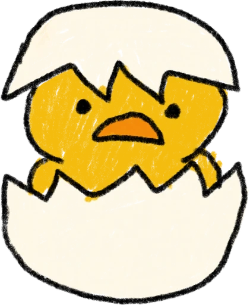

# 짹짹이

논문 파일을 열면 머리말·꼬리말, 쪽 번호, 각주, 그림·표 설명, 참고문헌은 빼고 본문만 브라우저 음성으로 읽어 줍니다.

- 지원 형식: PDF, 한글(HWP, HWPX), 엑셀(XLSX, XLS, CSV), TXT, 복사한 글 붙여넣기
- 본문 속 출처 표시([12], (Kim, 2021))를 빼고 읽거나 다 읽기 선택
- 시작 위치 선택(장·소제목 목록), 문장을 눌러 그 위치부터 듣기, 문장 하이라이트, 속도 조절
- 영어 논문 한 문장 + 한국어 번역 번갈아 읽기 (claude.ai 아티팩트로 열었을 때만)
- 스캔한 이미지 PDF 알아보기, Claude로 글자 인식해서 읽기 (claude.ai 아티팩트로 열었을 때만)

`index.html` 하나로 동작합니다. 브라우저로 열거나 GitHub Pages로 배포하면 PC와 휴대폰에서 모두 쓸 수 있습니다.

## 두 가지 버전

| | claude.ai 버전 | 웹 버전 (이 저장소, GitHub Pages) |
|---|---|---|
| 본문만 읽기, 출처 빼기, 시작 위치 선택 | 됨 | 됨 |
| 영어 한 문장 + 한국어 번역 | 됨 (Claude 로그인 필요) | 안 됨 — 버튼에 "번역 안 됨"으로 표시 |
| 스캔본 PDF 글자 인식 | 됨 (Claude 로그인 필요) | 안 됨 — claude.ai 버전으로 가는 링크 표시 |
| 홈 화면 아이콘 | claude.ai 아이콘 | 병아리 아이콘 |

## GitHub Pages로 올리기

1. 저장소 **Settings → General → Danger Zone → Change visibility**에서 공개로 바꿉니다. (비공개 저장소의 Pages는 GitHub 유료 요금제가 필요합니다.)
2. **Settings → Pages → Build and deployment**에서 Source를 **Deploy from a branch**, Branch를 `main` / `/ (root)`로 고르고 저장합니다.
3. 1~2분 뒤 `https://aninsong77-dotcom.github.io/test/`에서 열립니다.

---

# 녹음기 (따로 쓰는 앱)

`rec/` 폴더에 있는, 짹짹이와 상관없는 녹음 앱입니다. 윈도우 컴퓨터의 크롬이나 엣지에서 열어 쓰면 됩니다.

- **컴퓨터 소리만**: 줌, 유튜브처럼 컴퓨터에서 나는 소리
- **컴퓨터 + 바깥 소리**: 컴퓨터 소리와 마이크 소리(내 목소리, 주변 소리)를 함께 녹음. 이어폰을 쓸 때 추천합니다.
- **바깥 소리만**: 마이크로 들어오는 소리만

그 밖의 기능:

- 녹음하는 동안 들어오는 소리 크기가 막대로 보입니다. 소리가 한동안 안 들어오면 안내가 뜹니다.
- 일시정지할 수 있습니다.
- 5초마다 자동으로 저장해서, 창이 꺼져도 그때까지 녹음한 건 남습니다.
- 녹음은 이 컴퓨터의 브라우저 안에만 저장되고, 어디에도 올라가지 않습니다.
- 목록에서 바로 듣고, 이름을 바꾸고, **파일로 저장**을 누르면 다운로드 폴더에 `.webm` 파일로 저장됩니다. 크롬, 엣지, 윈도우 미디어 플레이어, VLC에서 재생됩니다.
- 크롬이나 엣지에서 **컴퓨터에 앱으로 설치**를 누르면 따로 된 창과 아이콘으로 쓸 수 있습니다.

주소: GitHub Pages를 켜면 `https://aninsong77-dotcom.github.io/test/rec/` 에서 열립니다. 켜는 방법은 위의 "GitHub Pages로 올리기"와 같습니다.

`rec/fix-webm-duration.js`는 [fix-webm-duration](https://github.com/yusitnikov/fix-webm-duration) 1.0.6(MIT 라이선스)입니다. 저장한 파일에 길이 정보를 넣어서, 재생할 때 원하는 위치로 바로 넘길 수 있게 해 줍니다.

---

# A-508057 (바닷속)

`a-508057/` 폴더에 있는, 짹짹이·녹음기와 상관없는 3D 공간입니다. 햇빛이 드는 밝은 바닷속(수심 30 m)에 투명 돔이 있고, 세 사람이 같은 시간에 같은 명상 음성을 들을 수 있습니다. 브라우저에서 열면 바로 됩니다. 설치나 가입은 필요 없습니다.

- **들어오기**: 바다 밖 해변에서 내 모습이 물방울 안에 선 채로 바다 위를 떠가다가 **첨벙** 들어갑니다. 물고기들 사이로 내려가 투명 돔 안 빈 방석에 내려앉으면 물방울이 **톡** 터지고 앉게 됩니다. 위쪽에 수심이 표시됩니다. **건너뛰기**로 바로 방석에 앉을 수 있고, **바다 위부터 다시**로 다시 볼 수 있습니다.
- **나가기**: 명상이 끝나면 다시 물방울에 싸여 돔 위로 떠올라 수면을 뚫고 해변에 내려앉고, 물방울이 터집니다. "함께해 주셔서 고마워요" 안내가 나오고, 창을 닫으면 나가집니다. **다시 바다로**를 누르면 다시 들어갑니다.
- **모습**: 머리가 크고 몸이 동글동글한 2등신 캐릭터입니다. 반짝이는 작은 눈과 볼터치가 있고, 옷은 단색 파스텔(사람마다 색이 다름)입니다. 서 있을 때는 가끔 눈을 깜빡이고, 방석과 해변에서 다리를 포개고 앉으면 눈을 감고 명상합니다. 물방울 안에서와 걸을 때는 서 있습니다. 다른 사람이 들어오면 그 사람의 모습도 보입니다.
- **물방울과 첨벙**: 물방울은 가장자리가 무지갯빛으로 빛나고 살짝 출렁입니다. 바다에 들어가고 나올 때 물기둥과 물방울이 튀고 수면에 물결이 퍼집니다. 도착하면 물방울이 살짝 부풀었다가 터지며 작은 물방울이 사방으로 튑니다.
- **들어오기와 나가기**: 링크를 열면 빛 속에서 **바로 유리 돔 안**으로 들어와 빈 방석에 앉습니다. 돔 밖으로는 나갈 수 없습니다. 돔 안에서 차를 마시고 명상하다가, 위쪽 **나가기**를 누르면 빛 기둥을 타고 위로 올라가며 끝납니다. 끝 화면에서 **다시 들어오기**를 누르면 다시 돔 안으로 들어옵니다. 다른 사람에게도 내가 빛을 타고 올라가는 모습이 보이고, 다 나가면 사라집니다.
- **시점**: 기본은 **내 아바타의 눈으로 보는 시점**입니다. 방석에 앉으면 눈앞에 가운데 명상 등과 다른 두 방석에 앉은 사람이 보이고, 차를 마실 때는 찻상과 두 손이 보입니다. 화면을 끌면 고개를 돌리고, 위로 끌면 바다 위쪽을 올려다봅니다. 위쪽 **내 모습 보기** 버튼(PC는 V 키, 또는 마우스 휠을 뒤로)으로 뒤에서 내 모습을 보는 시점으로 바꿀 수 있습니다. 물방울을 타고 오갈 때와 해변에서는 내 모습이 보이는 장면으로 보여 줍니다.
- **조작**: 버튼은 **종 치기**, **사진 찍기**, **차 마시기** 세 개뿐입니다. 나머지는 키보드나 화면 터치로 합니다.
  - 움직이기: 바닥을 누르거나 방향키(W A S D), 휴대폰은 왼쪽 아래 원
  - 방석에 앉기: 방석을 누르거나 F 키. 움직이면 일어납니다.
  - 인사: 눈으로 보는 시점에서는 화면을 두 번 톡 누르면 손 흔들기, 꾹 누르면 합장 인사. 내 모습 보기 시점에서는 내 모습을 누르면 됩니다. PC는 1(안녕하세요), 2(합장)
  - 3 종 치기, 4 차 마시기, P 사진 찍기
  - 둘러보기: 화면을 끌기. 위로 끌면 고개를 들어 반짝이는 수면을 올려다봅니다. 마우스 휠로 가까이·멀리.
  - 구글 폼·패들렛은 돔 안 안내판을 누르면 열립니다. 기록 사진과 링크 넣기(진행자)는 위쪽 작은 버튼에 있습니다.
- **차 마시기**: 찻상 앞으로 걸어가 앉아서, 주전자를 들어 잔에 차를 따르고, 잔을 두 손으로 들어 두 번 홀짝인 뒤 다시 찻상에 내려놓습니다. 찻상의 잔이나 주전자를 눌러도 됩니다. 다른 사람이 차를 마시는 모습도 보입니다.
- **물방울 보호**: 돔 밖 바다로 나가면 물방울이 늘 감싸 주고, 돔 안으로 들어오면 자연스럽게 톡 터집니다.
- **사진 찍기**: 진행자는 기록 사진에 남기고, 다른 사람은 내 기기에 저장합니다.
- **바닷속**: 맑은 청록빛 바다에 햇살 기둥이 일렁이고 작은 물빛이 반짝입니다. 물고기 떼 다섯 무리, 혹등고래 엄마와 새끼, 헤엄치는 거북이 둘, 해파리, 다시마 숲, 모래에서 올라오는 공기 방울 기둥, 돔 둘레의 알록달록한 산호와 살랑이는 말미잘이 있습니다. 바닥에는 물결무늬 햇빛이 일렁이고, 위를 보면 반짝이는 수면이 보입니다.
- **빛나는 생물 9개**: 바닥 곳곳에 있고, 가까이 가면 밝아집니다.
- **빛 띄우기**: 돔 밖에서 **빛 띄우기** 버튼(PC는 스페이스바)을 누르면 내 앞에 빛이 생깁니다. 띄운 빛은 이 기기의 브라우저에만 저장되고, 다시 열어도 남아 있습니다.
- **투명 돔**: 아주 가는 은빛 뼈대에 맑은 유리로 된 돔입니다. 가장자리만 은은하게 빛나서 밖의 바다가 잘 보입니다. 돔 밖에서는 **돔으로 가기** 버튼으로 바로 갈 수 있습니다.
  - 가운데 명상 등을 둘러싼 **방석 세 개**, 한쪽에 **티 테이블**(찻주전자, 잔과 받침 세 벌), 다른 쪽에 **구글 폼**과 **패들렛** 안내판이 있습니다.
  - **방석에 앉기** 버튼이나 방석을 누르면 앉습니다. 움직이면 일어납니다.
  - **안녕하세요**(오른손을 들어 흔들기), **합장 인사**(두 손을 가슴 앞에 모으고 천천히 고개 숙였다 일어나기), **차 마시기**(두 손으로 찻잔을 들고 두 번 홀짝이기)를 할 수 있습니다. 티 테이블의 찻잔이나 주전자를 눌러도 차를 마십니다. 머리 위에 아주 작은 글씨가 잠깐 뜹니다. 대화 기능은 없습니다.
  - 안내판이나 아래쪽 링크 버튼을 누르면 구글 폼과 패들렛이 새 창에서 열립니다.
- **함께 명상하기** (claude.ai 링크로 열었을 때만 됩니다)
  - 같은 링크로 들어온 사람끼리 서로의 빛과 이름이 보입니다. 인사도 서로에게 보입니다.
  - **매일 오전 9시(한국 시각)에 자동으로 시작**합니다. 종이 울리고 모든 사람의 화면에서 같은 명상 음성이 같은 지점부터 나옵니다. 늦게 들어와도 진행 중인 지점부터 함께 듣습니다.
  - 9시 명상이 끝난 뒤에는 언제든 돔에 들어와 **종 치기**(또는 돔 뒤쪽 싱잉볼)를 누르면 싱잉볼 소리가 '웅~' 하고 넘실대며 10초 넘게 퍼지고, 4초 뒤 명상이 시작됩니다. 그때 돔 안에 있던 사람도 함께 시작합니다. **명상 그만하기**로 멈출 수 있습니다.
  - 9시 명상이 시작되고 15초 뒤와 끝나기 8초 전에 진행자 화면이 **기록 사진**으로 남습니다. 진행자(편집 권한이 있는 사람)의 창이 그 시간에 열려 있어야 합니다. 진행자는 **지금 사진 남기기**로 언제든 한 장 남길 수 있습니다. 사진은 **기록 사진** 버튼에서 모두 볼 수 있습니다.
  - 진행자만 **링크 넣기**로 구글 폼과 패들렛 주소를 넣을 수 있습니다.
  - 브라우저는 사람이 한 번 눌러 줘야 소리를 낼 수 있어서, 방석에 앉거나 인사 버튼을 누르면 소리가 준비됩니다. 그래도 안 들리면 **소리 켜기** 버튼이 나옵니다. 기기 시계 차이 때문에 1초 정도 어긋날 수 있습니다.
  - 명상 음성 파일은 `a-508057/meditation.mp3`로 넣습니다. 파일이 없으면 "명상 음성을 아직 넣지 않았어요"라고 나옵니다.
  - GitHub Pages 주소로 열면 혼자 쓰는 화면이 됩니다. 9시 자동 시작과 종은 되지만, 함께하기, 링크, 기록 사진은 되지 않습니다.

주소: GitHub Pages를 켜면 `https://aninsong77-dotcom.github.io/test/a-508057/` 에서 열립니다. 켜는 방법은 위의 "GitHub Pages로 올리기"와 같습니다.

3D 그림은 [three.js](https://threejs.org) 0.160.0(MIT 라이선스)으로 그리고, 열 때 인터넷(jsDelivr)에서 불러옵니다.
